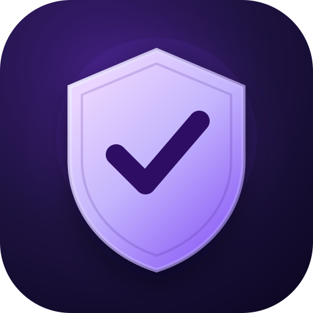
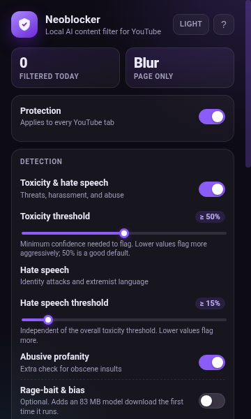
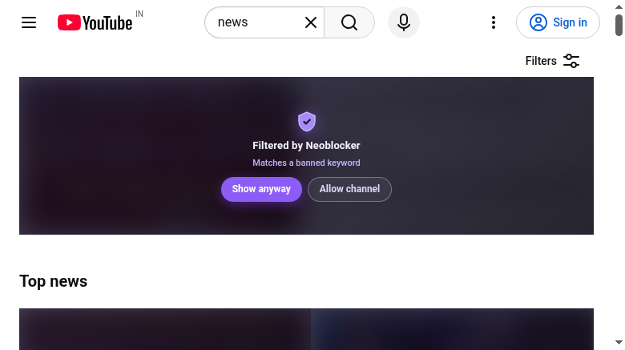

<p align="center">
  
</p>

<h1 align="center">Neoblocker</h1>

<p align="center">
  <strong>On-device AI content filtering for YouTube.</strong><br>
  Blur or hide toxic, hateful, and rage-bait content before you have to read it.
</p>

<p align="center">
  <a href="https://github.com/g1gowda123/Neoblocker/actions/workflows/ci.yml"></a>
  <a href="https://github.com/g1gowda123/Neoblocker/releases"></a>
  <a href="LICENSE"></a>
</p>

---

Neoblocker is a Manifest V3 browser extension that runs small text classifiers **inside your browser**. It watches YouTube cards and comments, sends text to a local model, and replaces flagged items with a quiet "Filtered by Neoblocker" overlay. There is no account, no analytics, and no inference API.

The toxicity model is bundled with the extension, so filtering works out of the box with no model download. The optional bias/rage-bait model is downloaded from Hugging Face the first time you enable it and is then cached by the browser. Classification is local either way.

> **Privacy in one sentence:** the models run on your device; your browsing text is never uploaded to a server.

## Screenshots

<p align="center">
  
</p>

<p align="center">
  
</p>

## Features

- **Compact bundled model** — a 23 MB int8 toxicity/hate-speech classifier runs locally via Transformers.js and WebAssembly, with no first-run download.
- **Optional bias model** — adds an ~83 MB bias/rage-bait classifier only if you turn it on.
- **Fast title pass** — scans video titles as cards render, without waiting for a full page load.
- **Optional deep scan** — checks the title, description, and subtitles of cards that stay in view, capped at two concurrent requests. Off by default to keep home-screen data use at zero.
- **Your call on every block** — **Show anyway** reveals a single item for the tab session; **Allow channel** adds the channel to your exceptions.
- **Blur or hide** — blur with a reason, or remove flagged items from the page entirely.
- **Keyword rules** — always-block and never-block lists, matched against titles, channels, and comments.
- **Useful controls** — master pause switch, threshold sliders, per-model status, one-click model preload, daily filtered counter, and a badge on the toolbar icon.
- **Private by design** — settings and counts live in `chrome.storage.local`; the only network requests are to YouTube (watch pages and subtitles, only when deep scan is on) and, only if you enable the optional bias model, Hugging Face (model weights).
- **Accessible popup** — keyboard-friendly switches, labelled controls, light/dark themes, and a scrollable 360 px layout.

## Install

### From a release (recommended)

1. Download the latest `neoblocker-v*-chrome.zip` from [Releases](https://github.com/g1gowda123/Neoblocker/releases).
2. Unzip it into a permanent folder.
3. Open `chrome://extensions` (or `edge://extensions`) and enable **Developer mode**.
4. Click **Load unpacked** and select the unzipped folder.
5. Open YouTube. The shield badge appears in the toolbar; click it to configure filtering.

Chrome and Edge 102+ are supported. Firefox is not currently a supported target.

### From source

```bash
npm ci
npm run dev
```

Load `build/chrome-mv3-dev` as an unpacked extension. Plasmo rebuilds the extension when files change.

For a production build and zip:

```bash
npm run build
npm run package
```

The unpacked build is in `build/chrome-mv3-prod`; the distributable zip is `build/chrome-mv3-prod.zip`.

## Models

The toxicity classifier ships inside the extension, so the default filter works offline immediately. It is a quantized MiniLM model trained on the Jigsaw toxic-comment dataset:

| Model | Purpose | Size |
| --- | --- | ---: |
| `minuva/MiniLMv2-toxic-jigsaw-onnx` (bundled) | Toxicity, threats, insults, identity hate | ~23 MB |
| `protectai/distilroberta-bias-onnx` (optional) | Bias and sensational/rage-bait framing | ~83 MB |

The optional bias model is **off by default**. Enable **Rage-bait & bias** in the popup to download it on first use; it is cached afterwards. The popup shows progress and a **Preload** button for enabled models. If an optional download fails, check your connection and press **Preload** again.

Deep scan is the only feature that fetches extra YouTube data. It is **off by default**: title and on-page comment scanning make no additional requests beyond what YouTube already loaded. When enabled, a card must stay in the actual viewport for about 1.5 seconds before Neoblocker fetches its watch page and subtitles; comments are never fetched for deep scan. The measured cost is roughly 140 KB per video, with at most two requests in flight. In a 20-card results page, leaving deep scan off produced zero extension requests; scrolling two screens with it on fetched eight watch pages, about 1.1 MB in total.

## How it works

```text
┌──────────────────────────────┐
│ YouTube page                 │
│  content-observer.ts         │
│  · watches cards/comments    │
│  · fast title + comment pass │
│  · visible-card deep scan    │
│  · blur/hide + overlay       │
└──────────────┬───────────────┘
               │ chrome.runtime messages
┌──────────────▼───────────────┐
│ background service worker    │
│  · message validation        │
│  · serialized ML inference   │
│  · TTL/LRU result caches     │
│  · YouTube fetch + sampling  │
│  · badge + daily stats       │
└──────────────┬───────────────┘
               │ Transformers.js / WASM
        ┌──────▼──────┐
        │ local model │
        └─────────────┘
```

- `src/contents/content-observer.ts` is a plain content script (no React, no host-page CSS framework). It injects a small stylesheet for the blur and overlay, observes DOM changes, and processes visible items.
- `src/background.ts` owns model execution and the network boundary. Messages are schema-checked and bounded; subtitle URLs and InnerTube parameters are validated before use; all fetches have timeouts.
- `src/utils/ai-router.ts` serializes inference, caches 400 recent results per model, samples long text (start/middle/end), and exposes model status/progress to the popup.
- `src/utils/storage.ts` sanitizes stored settings, serializes writes, and maintains the daily counter.
- `src/popup.tsx` and `src/style.css` implement the settings UI.

### Detection pipeline

1. **Exceptions** are checked first; matching text is always allowed.
2. **Banned keywords** are checked next; matching cards/comments are always blocked.
3. **Titles** get a fast toxicity pass with stricter gates for threats, hate speech, and severe insults.
4. **Comments and deep scans** use the full gate set, including a positivity/context buffer so documentaries and educational discussions are not blocked for merely mentioning a sensitive topic. Sexual content is not filtered; use YouTube's own 18+ restriction for that.
5. **Bias** is optional and only used as a supporting signal alongside toxic tone, which keeps rage-bait detection from turning into a generic opinion filter.

Thresholds are clamped to 5–95% and interpreted as **minimum confidence to block**. Lower values are stricter.

## Configuration

| Setting | What it does |
| --- | --- |
| **Protection** | Master switch. Pausing restores every filtered item on the current page. |
| **Toxicity & hate speech** | Enables the toxicity model and the title/comment gates. |
| **Toxicity threshold** | Overall confidence needed to block; lower flags more. |
| **Hate speech threshold** | Separate threshold for identity attacks and extremist language. |
| **Abusive profanity** | Extra obscene-insult check. |
| **Rage-bait & bias** | Optional ~83 MB bias model; only blocks biased text with toxic signals. Off by default. |
| **Bias threshold** | Confidence threshold for the bias/rage-bait signal. |
| **Deep scan** | Off by default. Fetches the watch page and subtitles for cards that stay in view. Leave off on metered connections. |
| **Filter mode** | **Blur with reason** or **Hide completely**. |
| **Always block / Never block** | Comma-separated keyword lists. Matching is case-insensitive substring matching. |
| **Restore hidden items** | Reveals everything currently filtered on the active YouTube tab for this session. |
| **Preload** | Downloads and warms the enabled models. |
| **Clear counter / Reset all settings** | Resets today's count or all settings to defaults. |

### Keyboard and accessibility

The popup uses native buttons, labelled sliders, and `role="switch"` controls. All controls can be reached with Tab and operated with Enter/Space/arrow keys. The theme follows the in-popup toggle rather than the OS setting, so it stays consistent.

## Development

Requirements: Node.js 20+ and npm.

```bash
npm ci          # install exact dependencies
npm run dev     # Plasmo dev build + watcher
npm run build   # production Chrome MV3 build
npm run package # zip build/chrome-mv3-prod
npm test        # Vitest unit tests
npm run typecheck
npm run check   # typecheck + tests
```

The test suite covers HTML/URL extraction and validation, keyword parsing, settings sanitization/storage serialization, stats, and model decision thresholds. It runs in Node with a small `chrome` API mock; no browser is required.

### Project layout

```text
src/
  background.ts                 service worker: messages, fetch boundary, stats/badge
  contents/content-observer.ts  YouTube DOM observer, overlays, reveal state
  popup.tsx                     settings UI
  style.css                     self-contained popup styles
  utils/
    ai-router.ts                model loading, inference queue, decision gates
    extract.ts                  HTML/YouTube parsing and validation helpers
    keywords.ts                 keyword list parsing and regex cache
    storage.ts                  settings, stats, serialized storage writes
assets/
  icon.svg / icon.png           source and 512 px store icon
  models/minilm/                bundled toxicity model (Apache-2.0)
docs/                           README screenshots
```

The bundled model is derived from `minuva/MiniLMv2-toxic-jigsaw-onnx`; see `assets/models/minilm/NOTICE.md` for provenance and the local ONNX metadata change.

### Adding a rule or threshold

Detection gates live in `analyzeContent()` in `src/utils/ai-router.ts`. Add a unit test in `src/utils/ai-router.test.ts` for a block and a safe case, then run `npm run check`. Pure parsing/validation helpers belong in `src/utils/extract.ts` and should be tested in `src/utils/extract.test.ts`.

## Privacy and permissions

Neoblocker requests only:

- `storage` — save settings and the local daily counter.
- `https://youtube.com/*` and `https://*.youtube.com/*` — run the content script and, when deep scan is enabled, fetch watch pages and subtitles.
- `https://huggingface.co/*`, `https://*.huggingface.co/*`, `https://*.hf.co/*` — download the optional bias model weights when you enable it.

There is no `tabs`, `history`, `cookies`, or `<all_urls>` permission. The extension does not read or transmit pages other than YouTube, does not use cookies or credentials for its fetches, and does not include analytics or remote code. Reveal choices are stored in `sessionStorage` for the current tab session; settings and the daily count are stored in `chrome.storage.local`.

## Limitations

- The bundled classifier is trained primarily on English text. Other languages may be under-filtered.
- Neoblocker does not filter sexual content. YouTube already provides an account-level 18+ restriction that is more reliable than a text classifier.
- The optional bias model is larger (~83 MB) and is off by default to keep installation and first-run bandwidth small.
- This is a heuristic content filter, not a parental-control or security boundary. Do not rely on it as the only safeguard for a child or a shared device.
- YouTube changes its DOM regularly. If cards stop being recognized, open an issue with the browser version and a screenshot.
- Deep scan is opt-in because it fetches public video text from YouTube and adds latency and network usage. It waits for a viewport dwell, never fetches offscreen cards, and is limited to two concurrent requests.
- The bundled model loads locally in well under a second. The optional bias model downloads ~83 MB on first use; the UI reports progress and allows retries.

## Troubleshooting

| Problem | Fix |
| --- | --- |
| Nothing is filtered | Check that **Protection** is on and the page was reloaded after installing. Open the popup on a YouTube tab. |
| "Model unavailable" / model error | The bundled toxicity model should load offline; reload the extension. If the optional bias model is enabled, check your connection, press **Preload**, and retry. |
| Deep scan never finishes | Turn it off or try a shorter video. Subtitle availability varies by video. |
| Popup says "Open a YouTube tab first" | The restore action needs an active YouTube tab running the content script. Reload that tab after updating the extension. |
| Stale UI after an update | Reload the extension in `chrome://extensions`, then reload YouTube. |

## Contributing

Issues and pull requests are welcome. Before opening a PR:

```bash
npm ci
npm run check
npm run build
```

Keep changes focused, add tests for parsing/decision logic, and do not add remote inference or broad host permissions. Security-sensitive changes should preserve the existing validation and timeout boundaries.

## License

[MIT](LICENSE) © 2026 Neoblocker

---

If Neoblocker makes YouTube calmer for you, consider starring the repo. It helps other people find it.
