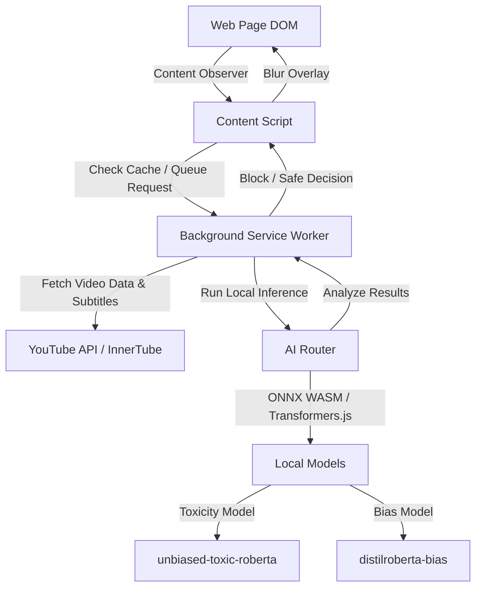

# Neoblocker — Cognitive Defense Firewall

Neoblocker is a privacy-first, fully offline Manifest V3 browser extension that acts as an intelligent content firewall. It detects and blocks toxic content, hate speech, clickbait, and media bias in real time directly within the browser using WebAssembly-based Machine Learning models. No user data or scanned text ever leaves the local device.

---

## 🚀 Key Features

* **Fully Local Inference**: Leverages ONNX Runtime Web via Transformers.js to execute NLP models directly in the browser's extension context.
* **Cascaded Protection Filters**:
  * **Pass One (Fast-Scan)**: Instantly scans video titles and channels to apply quick blocking before full page rendering.
  * **Pass Two (Deep-Scan)**: Fetches and analyzes video descriptions, English subtitles, and comments in the background.
* **Multi-Dimensional AI Classification**:
  * **Toxicity Classifier**: Analyzes text across multiple labels (toxicity, severe toxicity, obscenity, threats, insults, identity attack).
  * **Bias & Clickbait Classifier**: Filters political slant, opinionated baiting, and sensationalized media framing.
* **Contextual Allowlist & Exceptions**:
  * Employs a **Positivity Buffer** to avoid false positives on educational, historical, and gaming content.
  * Supports user-defined keyword bypass rules.
* **Premium Warning Overlay**: Injects a custom React banner over violating content, utilizing backdrop-blur transitions (`filter: blur(15px)`) for a non-intrusive yet secure user interface.

---

## 🏗️ Architecture



### 1. Content Script (`src/contents/content-observer.tsx`)
Monitors the DOM using a `MutationObserver` to locate video cards, feeds, comments, and sidebars. It communicates with the background service worker to fetch analysis decisions and applies an elegant blurred CSS filter over blocked items.

### 2. Background Script (`src/background.ts`)
Orchestrates metadata collection. It extracts video metadata, parses XML subtitles, and retrieves comments via the InnerTube POST API in parallel, caching evaluation results for performance optimization.

### 3. AI Inference Router (`src/utils/ai-router.ts`)
Manages model loading and lifecycle:
* **Toxicity Model**: Quantized `protectai/unbiased-toxic-roberta-onnx` running on CPU WebAssembly.
* **Bias Model**: Quantized `protectai/distilroberta-bias-onnx`.
* **WASM Worker Config**: Fine-tuned for Manifest V3 to run single-threaded (no `SharedArrayBuffer` support in MV3 workers).

---

## 📂 Project Structure

```
extension2/
├── .agents/               # LLM system instructions & architecture rules
├── .github/               # Automated submit workflows
├── api/                   # [Archived] Legacy prototype server (FastAPI)
├── assets/                # Design assets and logos
├── src/
│   ├── contents/          # DOM observation and React warning overlays
│   │   └── content-observer.tsx
│   ├── utils/             # Local ML classification & Chrome Storage config
│   │   ├── ai-router.ts
│   │   └── storage.ts
│   ├── background.ts      # Subtitle/comment fetcher and coordination layer
│   ├── popup.tsx          # Settings dashboard and status monitor
│   └── style.css          # Core CSS stylesheet
├── package.json           # WASM copy scripts and Plasmo manifest declarations
└── tsconfig.json          # TypeScript build paths
```

---

## 🛠️ Getting Started

### Prerequisites
* **Node.js** (v16.x or newer recommended)
* **npm**

### Installation

1. Install dependencies:
   ```bash
   npm install
   ```

2. Start the hot-reloading development server:
   ```bash
   npm run dev
   ```
   *This automatically copies the ONNX runtime `.wasm` files to the output directory and starts the Plasmo development server.*

3. Load the extension in Chrome:
   - Go to `chrome://extensions/`
   - Enable **Developer mode** (top right toggle)
   - Click **Load unpacked** (top left button)
   - Select the `build/chrome-mv3-dev` directory in your workspace.

> [!NOTE]
> On the very first run (or when visiting YouTube for the first time), the extension will take about 1-2 minutes to pull down and cache the local ONNX models. Once loaded, refresh the page and the offline protection will activate.

---

## 📦 Building for Production

To compile and optimize the extension for browser submission:

* **Chrome (Manifest V3)**:
  ```bash
  npm run build
  ```
  *(Runs `plasmo build --target=chrome-mv3` and copies WASM production binaries to `build/chrome-mv3-prod/`)*

* **Firefox (Manifest V3)**:
  ```bash
  npm run build:firefox
  ```

To package the production files into a distributable zip:
```bash
npm run package
```

---

## 🔒 Privacy & Security

* **Zero Data Exfiltration**: All text analysis is processed locally using ONNX Runtime. Text payloads, video histories, and settings never leave your device.
* **Strict CSP**: The extension complies with Manifest V3 Security Guidelines, configuring `wasm-unsafe-eval` specifically for offline local tensor math operations while disallowing remote script injection.
